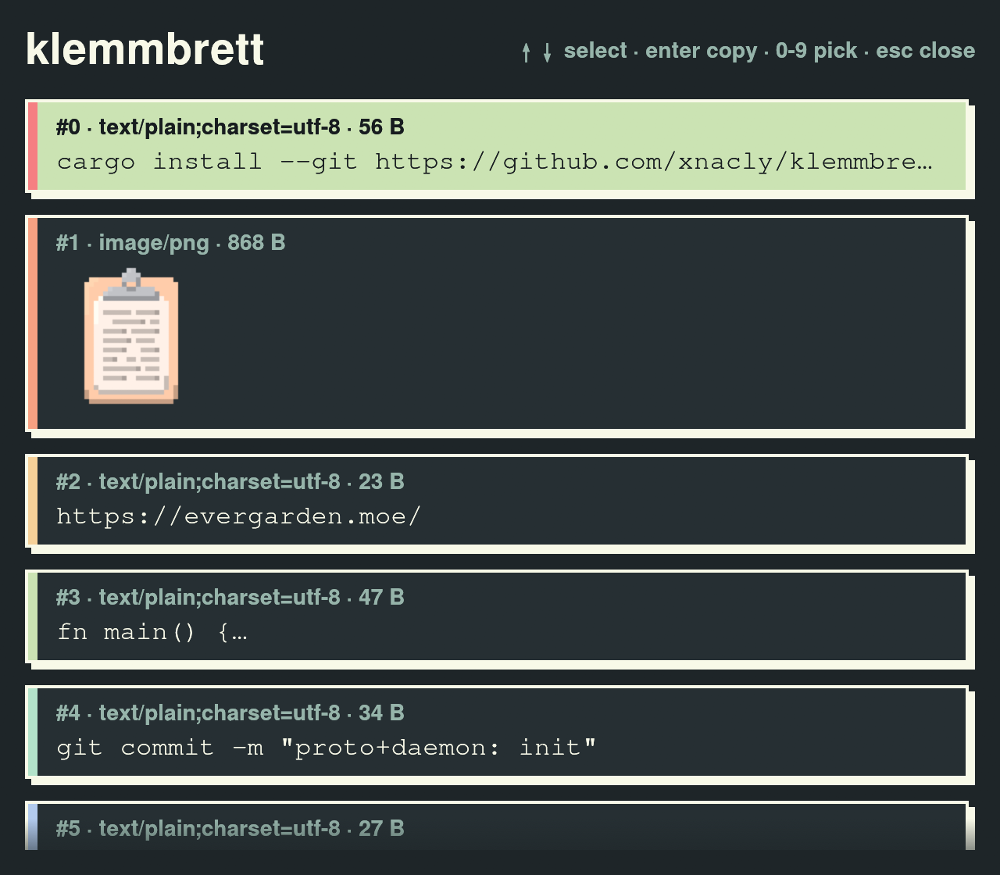
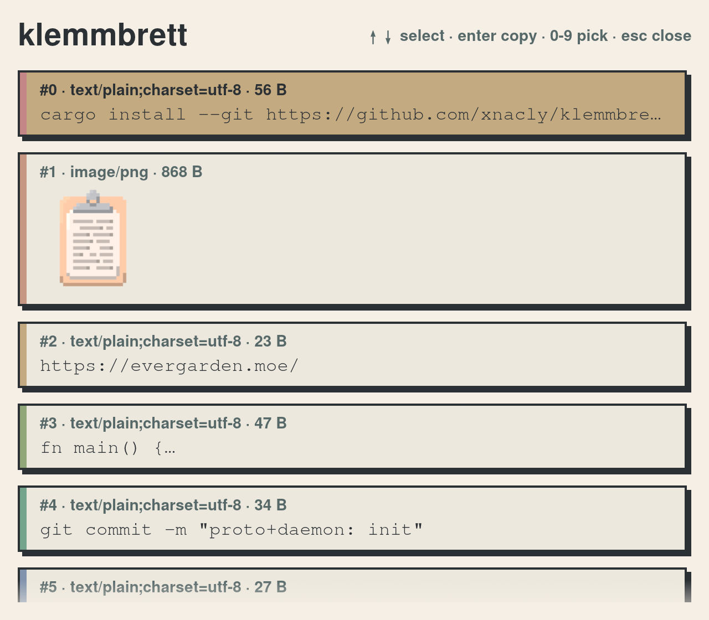

# klemmbrett

<p align="center">
    
</p>

Minimalist, dumb and fast wayland native clipboard history manager

- text previews and image thumbnails
- cli for listing and picking entries
- picker ui, mouse or keyboard (arrow keys/`jk`, `enter`, `0-9`, `esc`)
- themeable via toml, see the [default configuration](assets/evergarden.toml)

| [evergarden winter](assets/evergarden.toml) (default)                                    | evergarden summer                                                                        |
| ---------------------------------------------------------------------------------------- | ---------------------------------------------------------------------------------------- |
|  |  |

## Compositor support

- klemmbrett is wayland only, no X11 support. 
- daemon requires the `wlr-data-control` protocol: wlroot based compositors implement it
(sway, river, labwc, ...), Hyprland, niri and KDE Plasma, GNOME does not

## Install

```sh
cargo install --git https://github.com/xnacly/klemmbrett
```

Install the icon and desktop entry, so launchers and docks show it:

```sh
git clone https://github.com/xnacly/klemmbrett && cd klemmbrett
for size in 32 64 128; do
    install -Dm644 assets/icon${size}x${size}.png ~/.local/share/icons/hicolor/${size}x${size}/apps/klemmbrett.png
done
install -Dm644 assets/klemmbrett.desktop ~/.local/share/applications/klemmbrett.desktop
```

## Usage

```sh
klemmbrett daemon   # start the history daemon
klemmbrett ui       # open the picker
klemmbrett list     # list entries
klemmbrett pick 3   # copy entry 3
```

## Theme

Copy the [default configuration](assets/evergarden.toml) to
`~/.config/klemmbrett/theme.toml`, missing keys fall back to the defaults.
